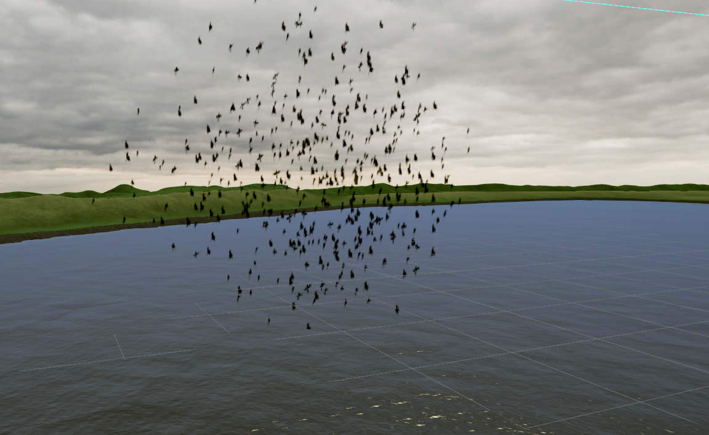

# Video Animations



## Description

Two independent tools for getting background animated effects (birds,
smoke, fire, water, etc.) into a GSPro-compatible scene. They're designed
to work well together as one pipeline — render an animation in Blender,
convert it to video, then display it in Unity — but each piece stands on
its own too. If you already have your own alpha-channel video from
somewhere else, you can skip straight to the Unity half.

- **Blender → WebM** (`png2webm.py`): converts a rendered PNG image
  sequence into a looping, alpha-transparent WebM video.
- **Unity: Quad from Video** (`MakeQuadFromVideo.cs`): turns any
  alpha-transparent video into a ready-to-place world-space Quad prefab.

## Installation

**Option A — import the `.unitypackage`** (easiest, for the Unity tool):
download the latest `.unitypackage` from this repo's
[Releases page](https://github.com/mmoore0011/chickenandribs_videoanimations/releases/latest),
then in Unity: **Assets → Import Package → Custom Package…** and select
the downloaded file. `png2webm.py` isn't part of the Unity package since
it runs outside Unity entirely (see below for that one).

**Option B — copy into your project**: copy `Editor/MakeQuadFromVideo.cs`
into your Unity project's `Assets/` (inside a folder literally named
**Editor**, as always).

## Part 1 — Blender: PNG sequence to WebM

### Requirements

- Python 3
- [ffmpeg](https://ffmpeg.org/download.html) installed and on your
  system PATH (on Windows: add its `bin` folder to Environment Variables
  → PATH)

### Step-by-Step Instructions

1. **Render your animation as an RGBA PNG sequence** in Blender: Output
   → PNG, Color = RGBA, Film Transparent = enabled. Frame files can be
   named anything — the tool sorts them numerically. Put all frames for
   one animation in their own folder (e.g. `C:/renders/my_effect/`).
2. Open a terminal in this tool's folder and run:
   ```
   python png2webm.py
   ```
3. When prompted, paste the path to your PNG frames folder:
   ```
   Path to PNG frames folder: C:/renders/my_effect
   ```
4. The script sorts the PNGs numerically, builds a VP8 WebM video with
   alpha transparency, and saves it as `C:/renders/my_effect.webm`
   (named after the folder), printing the full output path when done.

**Configuration** — open `png2webm.py` and adjust these two lines near
the top if needed:

```python
SOURCE_FPS = 24.0   # frame rate of the source animation
FRAME_STEP = 1      # 1 = every frame rendered, 4 = every 4th frame, etc.
```

Playback speed = `SOURCE_FPS / FRAME_STEP`. Rendering every frame of a
24fps animation needs no changes to either default.

## Part 2 — Unity: Quad from Video

For placing a looping animated effect as world-space geometry in your
scene (a billboard-style quad showing the video).

### Requirements

- Unity 2018.2 or later (VideoPlayer module, included by default)
- A video with an alpha channel imported into your project (e.g. one
  made with Part 1 above, or your own)

### Step-by-Step Instructions

1. Drag your `.webm` (or other alpha-video) file into the project,
   anywhere under `Assets/`.
2. Select it in the Project panel.
3. **Tools → chickenandribs → Video Animations → Create Quad from
   Video** (greyed out unless a VideoClip is selected).
4. This creates `Assets/Video Animations/Prefabs/{video name}/`
   containing a RenderTexture sized to the video, an Unlit/Transparent
   material using it, and a Quad prefab with a VideoPlayer wired up.
5. Drag the `{name}_Quad.prefab` into your scene, scale it to size (if
   it appears mirrored, rotate Y by 180°), and press Play — it loops
   automatically.

## Troubleshooting

- **Alpha transparency looks wrong / video has a black background
  instead of transparent** — confirm the WebM was encoded with VP8 and
  `yuva420p` pixel format (what Part 1's script produces by default);
  Unity 2018+ supports this on Windows, and the Unlit/Transparent
  material this tool creates is what actually renders the alpha.
- **"Create Quad from Video" is greyed out** — make sure you have a
  VideoClip asset actually selected in the Project panel, not just any
  file.
- **Multiple videos' generated assets collide or overwrite each other**
  — they shouldn't: each video gets its own subfolder under
  `Assets/Video Animations/Prefabs/{video name}/`.
- No custom scripts are needed at GSPro runtime — this tool relies only
  on Unity's built-in VideoPlayer/Animation components, so it's
  compatible with GSPro's asset bundle export as-is.

## Feature Requests / Bug Reports

Please open an issue in this repository.
